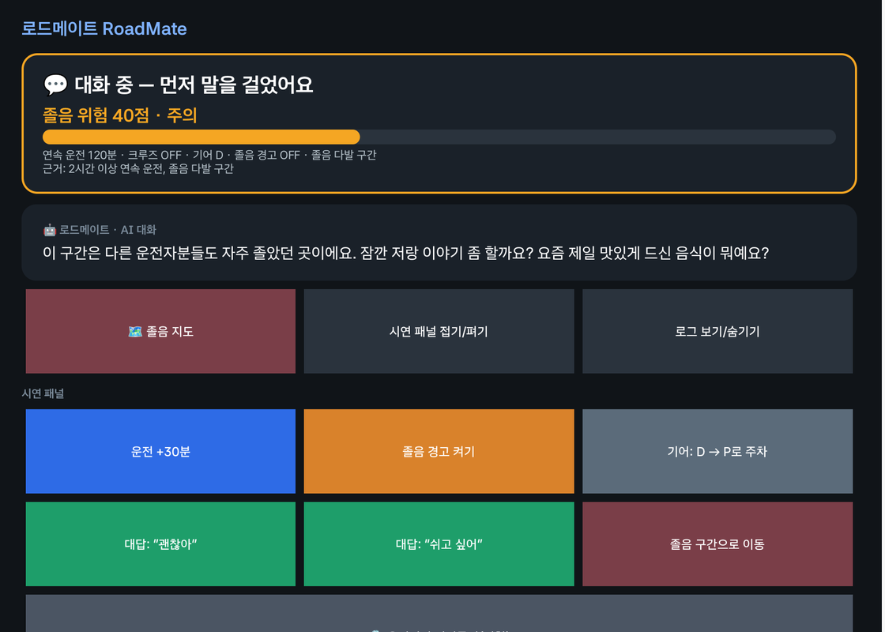
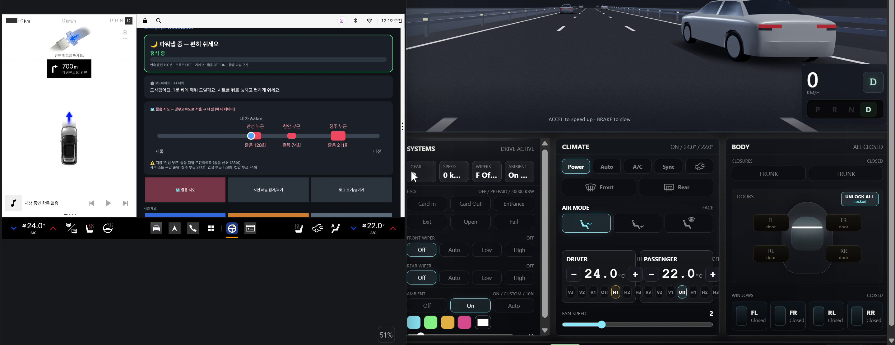
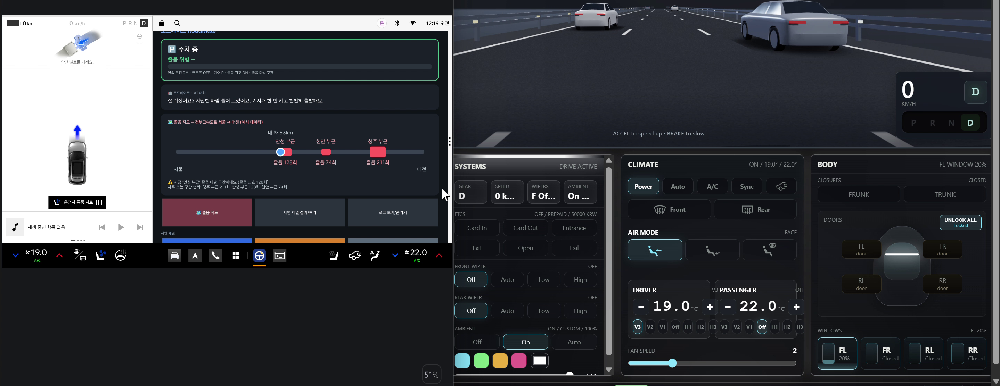
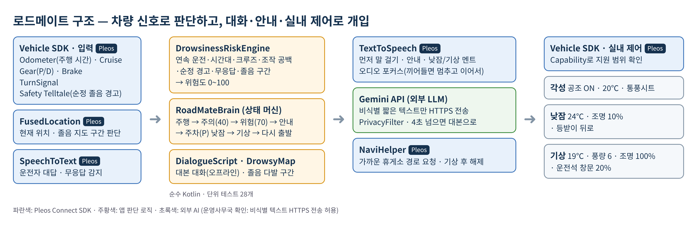

# 로드메이트 (RoadMate)


졸음의 시작부터 끝까지 책임지는 AI 동승자.
졸리기 전에 먼저 말을 걸고, 쉬어야 할 땐 차를 낮잠 공간으로 바꿔 개운하게 깨워주는 Pleos Connect 차량용 앱.

## 저장소
https://github.com/PJJ0337/RoadMate

## 화면
| 먼저 말 걸기 (위험도 '주의') | 졸음 지도 (예시 데이터) |
|---|---|
|  |  |

### 차량 제어 결과 (앱 + Virtual Console 같은 순간)
**파워냅** — 주차하면 실내 24℃, 조명 10%, 등받이 뒤로



**기상** — 19℃ 시원한 바람, 앰비언트 100%, 운전석 창문 20%



### 시연 영상
- https://youtu.be/dm11VHPn1Ck (2분 16초, YouTube 일부 공개 · 주행 시간·졸음 지도는 모의 데이터, 운전자 음성은 AI 재연)

## 구조


## 동작 흐름
1. **예측**: 연속 운전 시간·시간대·크루즈·운전자 조작·순정 졸음 경고·대답 여부로 졸음 위험 점수(0~100) 계산
2. **대화**: 주의 단계(40점~)면 로드메이트가 먼저 말을 걸고, 대답에 맞춰 같은 주제로 2번 더 이어서 대화 (대답이 없으면 위험 점수 상승)
3. **안내**: 위험 단계(70점~)거나 "쉬고 싶어"라고 하면 가까운 휴게소로 길 안내 + 시원한 바람
4. **파워냅**: 주차(P)하면 낮잠 모드 → 시간이 되면 기상 모드로 깨움

## 시연 방법
앱 하단 '시연 패널'에서 `운전 +30분`, `졸음 경고 켜기`, `기어 P → D`, `대답`, `졸음 구간으로 이동` 버튼으로 상황을 재현합니다.
`🗺 졸음 지도` 버튼으로 졸음 다발 구간 지도(예시 데이터)를 볼 수 있습니다.
(시연 모드: 말 걸기 간격 15초, 낮잠 30초)

## 실행 방법
1. Android Studio에서 `RoadMate` 폴더를 엽니다 (File > Open).
2. Gradle 동기화가 끝날 때까지 기다립니다.
3. Pleos Connect Emulator(AVD, v2.1.0 / API 34)를 실행합니다.
4. 상단 ▶ Run 버튼으로 `app`을 실행합니다.

## 음성 안내와 오디오 포커스
운영사무국 안내(주행 중 TTS 선제 안내 가능, 오디오 포커스 처리 필요)에 맞춰 처리합니다.
- 말하기 전 `AudioFocusRequest(AUDIOFOCUS_GAIN_TRANSIENT_MAY_DUCK)`로 포커스를 요청하고, 말하기·대답 듣기가 끝나면 반납
- `LOSS_TRANSIENT`(Gleo 호출 등): 즉시 멈춤 → 포커스가 돌아오면 하던 말을 이어서 / `LOSS`: 즉시 멈추고 반납 / `CAN_DUCK`: 소리만 낮춤
- 다른 음성이 재생 중이라 포커스를 못 받으면 3초 뒤 다시 시도
- 시연 패널 `🎙 음성비서 끼어들기(시험)` 버튼으로 확인할 수 있습니다.

## AI 대화 (선택)
Pleos LLM SDK가 에뮬레이터 v2.1.0(2026-10-19)부터 제공 종료되어, 외부 AI(Google Gemini API)로 자유 대화를 합니다.
- 키가 없으면 앱에 내장된 **기본 대본**으로 대화합니다 (인터넷 없이도 동작).
- 키를 쓰려면 프로젝트 루트의 `local.properties`(저장소에 올라가지 않음)에 아래 한 줄을 추가하고 다시 빌드합니다.
  ```
  GEMINI_API_KEY=발급받은_키
  # GEMINI_MODEL=gemini-flash-lite-latest   (선택, 기본값)
  ```
- AI 대답이 4초 안에 오지 않거나 실패하면 자동으로 기본 대본으로 대답합니다. "쉬고 싶어" 같은 휴식 요청은 AI보다 먼저 처리합니다.
- release 빌드는 개발용 키와 분리된 `GEMINI_API_KEY_RELEASE`만 사용합니다 (없으면 기본 대본).

### AI로 보내는 데이터
운영사무국 안내(비식별화된 짧은 텍스트를 HTTPS로 외부 LLM에 전송하는 방식 허용)에 맞춰 처리합니다.
- 보내는 것: 운전자 대답(기기 안 STT로 바꾼 텍스트), 연속 운전 시간·시각·졸음 위험 점수 같은 요약 정보, 최근 대화 12개까지
- 보내지 않는 것: 음성 원본, 영상, 위치 좌표, 차량 식별 정보. 별도 서버 없이 앱에서 Google API로 HTTPS 직접 호출
- 보내기 전에 `PrivacyFilter`가 전화번호·이메일·차량번호·긴 숫자열을 `[전화번호]` 같은 자리표시어로 바꾸고 200자로 자릅니다.

## 테스트
- 판단 로직 단위 테스트 28개 (`app/src/test`, Android Studio에서 `core` 폴더 우클릭 > Run Tests)

## 테스트 환경
- Pleos Connect Emulator v2.1.0 (Android Automotive, Android 14, API 34)
- 에뮬레이터 화면 규격: 2560 × 1440 px, 160 dpi (AVD `Pleos_Connect_v2.1.0`)
- Android Gradle Plugin 8.8.2 / Gradle 8.10.2 / Kotlin 2.0.0 / JDK 17
- minSdk 28, targetSdk 35
- Pleos Connect Virtual Console: `adb forward tcp:8088 tcp:8088` 후 http://127.0.0.1:8088/

## 사용 SDK
Vehicle 2.3.2 · TextToSpeech 3.3.1 · SpeechToText 3.3.1 · NaviHelper 3.0.5 · FusedLocation 1.1.3
(+ 선택: Google Gemini API — AI 자유 대화)

## APK
- 위치: [`apk/로드메이트_로드메이트_release.apk`](apk/) (팀명: 로드메이트, 앱 이름: 로드메이트)
- 설치: Pleos Connect Emulator 실행 후 APK 파일을 에뮬레이터 화면에 끌어다 놓거나 `adb install -r apk/로드메이트_로드메이트_release.apk`
- 실행: 앱 목록에서 **로드메이트** 실행 → 마이크·위치 권한 허용 → 시연 패널 버튼으로 상황 재현
- 마이크: 에뮬레이터 Extended controls(⋯) > Microphone에서 호스트 마이크 입력을 켜야 음성 대답이 인식됩니다.
- AI 대화: 제출용 APK에는 심사용 키가 들어 있어 인터넷 연결 시 AI 대화가 동작합니다. 키가 만료되거나 연결이 없으면 기본 대본으로 동작합니다.
- 서명: 바로 설치할 수 있도록 debug 키로 서명했습니다.

## 모의 데이터 안내
에뮬레이터에서 재현이 어려운 항목은 모의 데이터로 시연합니다 (운영사무국: 모의 데이터·대체 시연 심사 인정).
- 누적 주행 시간: Odometer 주행 시간 미지원 → 시연 버튼 `운전 +30분`
- 졸음 지도: 예시 구간 데이터 (실데이터 수집 서버는 향후 계획)
- 주행 경로: 경부고속도로 서울→대전 가정

## 개발 일지
[docs/개발일지.md](docs/개발일지.md)

## 참고
빌드 결과물은 OneDrive 동기화 충돌을 피하기 위해 `C:\Users\<사용자>\RoadMateBuild\`에 생성됩니다.
