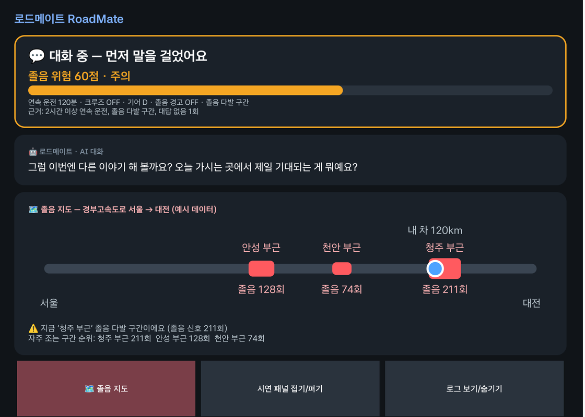

# 로드메이트 RoadMate

차량 신호로 휴식 필요 상황을 살피고, 짧은 음성 대화 → 휴게소 안내 → 사용자가 확인한 정차 휴식으로 이어 주는 Pleos Connect 앱입니다.

## 0.2.1 제출 검토 버전

이 버전은 공모전 시연용입니다. 말 걸기 간격은 15초, 낮잠 타이머는 30초로 압축했습니다. 화면 상단에서 시연 설정과 실제/모의 기어를 구분합니다. 실차에서 졸음 감지 정확도나 사고 감소 효과를 검증한 제품은 아닙니다.

### 0.2.1 추가 내용

- 공식 `CarUxRestrictionsManager`에서 현재 UX 정책을 읽고 변경 리스너를 등록합니다. 플랫폼 제한을 변경하지 않습니다.
- `NO_SETUP` 또는 정책 조회 미완료 상태에서 시연 패널·예시 지도·AI 설정·로그를 숨깁니다. 이미 열린 AI 동의창도 닫고, 실제 P 및 설정 허용 상태로 돌아왔을 때 다시 표시합니다.
- 내비게이션의 비동기 전환 때문에 확인창 표시가 늦으면 `휴식 시작 확인` 버튼으로 다시 열 수 있습니다. 버튼과 실제 휴식 시작 모두 실제 P와 대기 상태를 재확인합니다.
- 아래 0.2.0 안전 제어·AI 취소 로직은 유지했습니다. 현재 버전 빌드·화면 검증은 `docs/VALIDATION-0.2.1.md`, 이전 확장 검증은 `docs/VALIDATION-0.2.0.md`에 구분합니다.

### 0.2.0에서 추가한 내용

- 실제 Gear SDK의 P 신호와 시연 버튼의 모의 기어를 분리했습니다. 실제 P가 확인되지 않으면 낮잠·기상 차량 제어를 시작하지 않습니다.
- 실제 P 확인 후에도 `휴식 시작`을 눌러야 낮잠을 시작합니다. 정차 장소와 시트 주변을 확인하고 진행합니다.
- `휴식 중단`, 실제 기어 P 이탈 또는 기어 조회 실패 시 낮잠을 중단합니다. 이를 휴식 완료로 계산하지 않으며, 기상용 창문·시트 명령을 실행하지 않습니다.
- 예약된 공조 설정·풍량 재시도와 진행 중인 등받이 이동은 취소 시 중단합니다. 이미 적용된 온도·조명·창문 상태를 원래 값으로 자동 복원하는 기능은 없습니다.
- 외부 AI는 최초 동의 후 사용합니다. 거부해도 기본 대본과 휴식 흐름을 사용할 수 있습니다. 시연 패널의 `AI 대화 설정`에서 동의를 바꿀 수 있습니다.
- AI 지연 시 4초 뒤 기본 안내로 전환하며, 취소된 단계·이전 대화의 늦은 응답은 재생하지 않습니다.
- 시연 패널은 기본적으로 접혀 있습니다. 차량의 설정 음량을 임의로 높이지 않습니다.
- 표시 점수 이름을 `휴식 권고`로 바꿨습니다. 0~100은 규칙 기반 지표이며 졸음 확률이나 의학적 진단 점수가 아닙니다.

## 실행 환경과 빌드

- Pleos Connect Emulator v2.1.0 / Android 14 / API 34
- 기존 시연 화면: 2560 × 1440 px, 160 dpi
- Android Gradle Plugin 8.8.2 / Gradle wrapper 8.10.2 / Kotlin 2.0.0
- JDK 17 이상 / compileSdk 35 / targetSdk 35 / minSdk 28
- Vehicle 2.3.2 · TextToSpeech 3.3.1 · SpeechToText 3.3.1 · NaviHelper 3.0.5 · FusedLocation 1.1.3

1. Android Studio에서 프로젝트를 엽니다.
2. Android SDK Platform 35와 Build Tools 35.0.0을 설치합니다.
3. 로컬 `local.properties`에 Android Studio가 생성하는 `sdk.dir`을 설정합니다. 이 파일은 제출 소스에 포함하지 않습니다.
4. `gradlew.bat :app:testDebugUnitTest :app:assembleRelease`를 실행합니다.
5. 빌드 결과는 `app/build/outputs/apk/release/app-release.apk`입니다. 공모전 시연용 release는 debug 인증서로 서명합니다. 기존 설치본과 서명이 다르면 기존 앱 삭제 후 설치해야 하며 로컬 설정은 초기화됩니다.

## 새 버전 시연 순서

초기 설치 세션에서 실제 D 전환 시 화면 제한을 관찰했으나, 최종 APK 설치와 AVD 재시작 후 실제 D·5 km/h(MOVING)에서 화면이 정상 표시됐습니다. `CarUxRestrictions`는 0x50으로 활성화된 상태였으며 제한을 해제하거나 우회하지 않았습니다. 초기 현상의 원인은 확정하지 못했습니다. 실제 D+모의 P에서 낮잠 진입 차단도 확인했습니다. 0.2.1에서는 `NO_SETUP`에 따른 설정 UI 제한을 연동했습니다. 주행 중 음성 연속 동작과 다른 지역·차종 정책의 전체 대응은 추가 검증 과제입니다. 아래 휴식 시작·중단 검증은 **Console 실제 P**에서 진행합니다.

1. Pleos 에뮬레이터에서 설치·실행하고 마이크와 위치 권한을 허용합니다.
2. 외부 AI 사용 여부를 선택합니다. 인터넷이나 키 없이도 기본 대본으로 휴식 흐름을 확인할 수 있습니다.
3. Virtual Console의 Gear Selection을 P로 두고, 상단 실제 기어가 P로 표시되는지 확인합니다.
4. 시연 패널을 열어 `쉬고 싶어` 모의 대답으로 휴게소 안내를 요청합니다. 모의 입력임을 심사자에게 설명합니다.
5. 실제 P 확인 후 앱으로 복귀해 나타나는 확인창(표시가 늦으면 `휴식 시작 확인` 버튼)에서 주변과 시트 공간을 확인하고 `휴식 시작`을 누릅니다. 시연 기어를 사용했다면 먼저 `실제 기어로 복귀`를 누릅니다.
6. 30초 후 기상 흐름을 확인합니다. 별도 취소 검증은 다시 휴식을 시작한 뒤 `휴식 중단`을 누릅니다. 취소 시 기상용 창문·시트 동작을 시작하지 않아야 합니다.

`모의 기어` 버튼만으로 실제 P를 만들 수 없습니다. 실제 Gear SDK 신호가 미확인/D이면 낮잠·기상 차량 제어는 차단하도록 구현했습니다. 순수 Kotlin 테스트와, 실제 D+모의 P+휴식 요청 후 안내 상태를 유지하고 낮잠 확인창이 나타나지 않는 에뮬레이터 화면으로 확인했습니다. 안내 중 환기용 공조는 낮잠 제어와 별도입니다.

## 구현과 한계

| 기능 | 현재 범위 |
|---|---|
| 휴식 권고 | 시간·크루즈·조작·순정 경고·무응답에 따른 Kotlin 규칙. 임계값의 실차 예측 성능 미검증 |
| 주행 시간 | Vehicle Odometer 트립 시간 구독. 해당 에뮬레이터 미지원 시 버튼으로 시간을 가산 |
| 기어 | 실제 SDK 구독/초기 조회와 모의 입력 분리. 낮잠 제어는 실제 P 필수 |
| 대화 | Pleos 기기 내 STT/TTS. 규칙이 상태 전환을 결정하고 Gemini 출력은 대화문에만 사용 |
| 휴게소 안내 | 예시 장소 3개의 대략 좌표 중 직선거리 비교. 진행 방향·도로 접근 가능성·최단 주행시간 검증은 향후 과제 |
| 위치 없는 안내 | 기존 시연처럼 예시 첫 장소를 안내. 전국 실서비스용 검색이 아님 |
| 졸음 지도 | 예시 구간 데이터. 익명 집계 서버·실데이터 수집 없음 |
| 낮잠·기상 | 실제 P와 사용자 확인 후 지원 영역에 명령. 명령 전달과 물리 동작은 구분하여 Console에서 확인 필요 |
| 등받이 | 운전석 Capability 확인 후 뒤/앞 방향으로 최대 3초 이동. 저장한 원래 각도로 복원하는 기능은 없음 |
| 실행 범위 | Activity 기반. 차량 시동 시 자동 실행·백그라운드 서비스·프로세스 복원은 구현하지 않음 |

## AI와 데이터 처리

- Gemini는 생성된 짧은 문장을 TTS로 읽는 역할입니다. 차량 제어 명령이나 위험도 엔진을 직접 실행하지 않습니다.
- 음성 원본은 외부 전송하지 않습니다. Pleos STT가 만든 텍스트와 운전 시간·시각·점수 요약, 최근 대화 최대 12개를 HTTPS로 Google Gemini에 전송합니다.
- `PrivacyFilter`는 전화번호·이메일·차량번호·긴 숫자열을 마스킹하고 입력을 200자로 제한합니다. 이름·주소 등 자유형 개인정보를 모두 제거하지는 못합니다.
- 동의 거부, 키 없음, 네트워크 실패, 4초 지연 시 기본 대본으로 동작합니다.
- 키를 사용할 때만 로컬 `local.properties`에 `GEMINI_API_KEY`(개발용), `GEMINI_API_KEY_RELEASE`(제출용)를 설정합니다. `GEMINI_MODEL`은 선택입니다. 키를 저장소·소스 ZIP에 포함하지 마세요.
- 앱 내 API 키는 추출 가능하므로 제출용 키는 사용량 제한과 심사 후 폐기가 필요합니다. 출시 때는 별도 인증·키 관리 설계가 필요합니다.

## 테스트와 검증

`app/src/test`에 기존 위험도·대화·지도·PrivacyFilter 테스트와 주차 승인·취소·신호 상실·늦은 응답 방지 테스트를 포함합니다. 실제 실행 결과와 APK 해시는 `docs/VALIDATION-0.2.1.md`를 확인하세요. Kotlin 단위 테스트 통과가 Pleos 에뮬레이터나 실차 검증을 대신하지 않습니다.

## 기존 제출 참고자료

- 저장소: https://github.com/PJJ0337/RoadMate
- 기존 영상: https://youtu.be/dm11VHPn1Ck (2분 16초, 일부 공개)
- 기존 영상·스크린샷은 **0.1.0 시연 기록**입니다. 주행 시간·기어·지도 등에 모의 입력을 사용했고 운전자 음성은 AI 재연입니다. 새 버전의 확인창·실제 기어 차단·AI 동의 흐름을 증명하는 자료는 아닙니다.
- 최종 제출 소스 ZIP의 `apk/로드메이트_로드메이트_release.apk`는 0.2.1 제출 검토 APK입니다. 수신한 원본 0.1.0 APK는 별도 원본 폴더에 보존합니다. 저장소 업로드 전에는 공개 저장소의 APK가 여전히 0.1.0일 수 있으므로 버전과 해시를 확인하세요.

